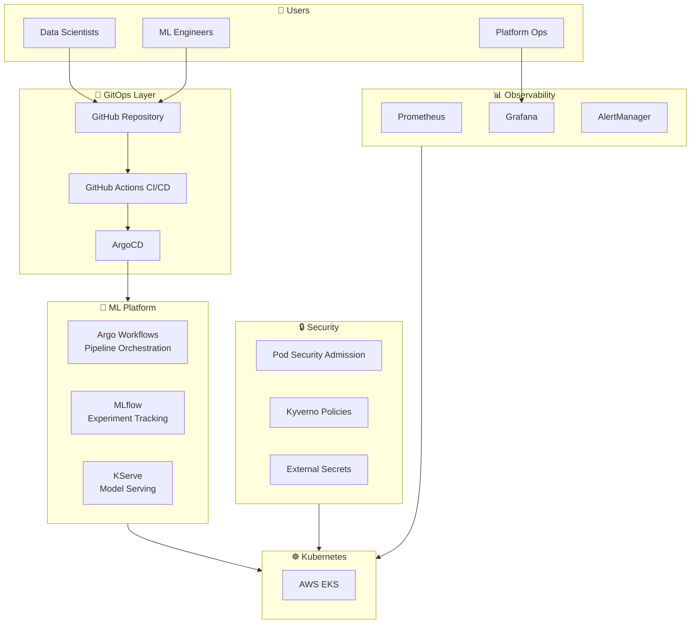
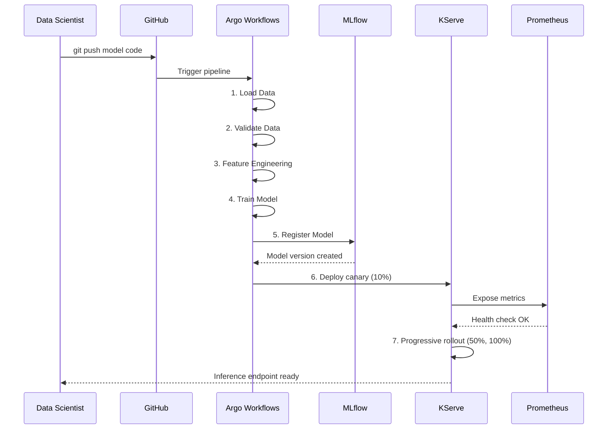
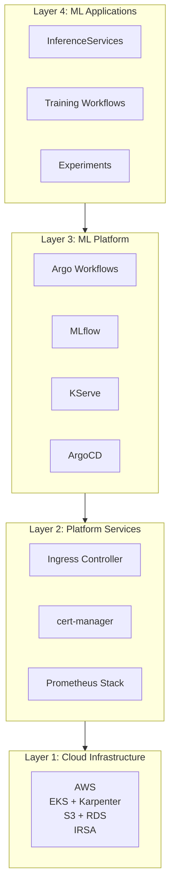
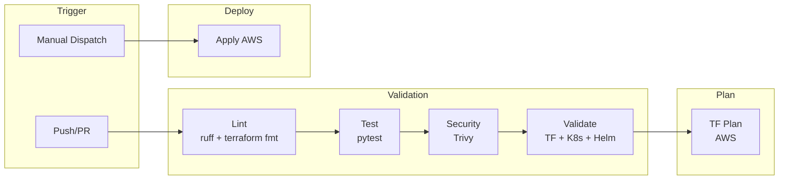

# MLOps Platform on AWS EKS

An MLOps **reference platform** for model training, versioning, and deployment on **AWS EKS**. Designed around a self-service path from experiment to production — end-to-end verification is in progress (see [Design Targets](#design-targets) and [Roadmap](#roadmap)).

Azure and GCP implementations were removed by [ADR-017](docs/adr/017-pivot-to-llm-inference-on-eks.md); the multi-cloud version is preserved at tag [`v1-classic-mlops`](https://github.com/judeoyovbaire/mlops-platform/tree/v1-classic-mlops).

[](https://github.com/judeoyovbaire/mlops-platform/actions/workflows/ci-cd.yaml)

## The Problem

ML teams often spend more time on infrastructure than on actual machine learning:

| Challenge | Traditional Approach | Time Cost |
|-----------|---------------------|-----------|
| Model deployment | Manual kubectl, Docker builds, config management | 2-3 days per model |
| Environment consistency | "Works on my machine" debugging | Hours of troubleshooting |
| Experiment tracking | Spreadsheets, local files, tribal knowledge | Lost experiments, no reproducibility |
| GPU resource management | Static allocation, idle resources | 60-70% underutilization |
| Production rollbacks | Manual intervention, downtime risk | 30+ minutes MTTR |

## The Solution

The target architecture: self-service ML infrastructure where data scientists deploy models without DevOps tickets (see [Design Targets](#design-targets) for verification status):

```
Data Scientist                    Platform (Automated)
     │                                    │
     ├── git push model code ────────────►├── CI validates & builds container
     │                                    ├── MLflow registers model version
     │                                    ├── KServe deploys with canary (10%)
     │                                    ├── Prometheus monitors latency/errors
     │                                    └── Auto-rollback if metrics degrade
     │                                    │
     └── Monitor in Grafana ◄─────────────┘
```

## Design Targets

This is a **reference architecture** — the numbers below are design targets and pricing benchmarks the platform is built to achieve, not measured production outcomes. Measured results will replace these as end-to-end verification lands (see roadmap).

| Metric | Typical industry baseline | Platform design target | Mechanism |
|--------|--------------------------|------------------------|-----------|
| Model deployment time | 2-3 days (manual process) | 15 minutes, self-service | CI → MLflow registry → KServe |
| Infrastructure setup per project | 40+ hours | ~2 hours | Terraform modules + self-service workflows |
| GPU cost | On-demand pricing | ~60% lower | Spot/preemptible instances + Karpenter consolidation + scale-to-zero |
| Failed deployment recovery | 30+ min manual | <2 min auto-rollback | Canary analysis + automated rollback |
| Experiment reproducibility | Ad-hoc | 100% tracked | MLflow autologging + model registry |

## Verification Status

**AWS (EKS)**: 🔄 End-to-end verification in progress: CI deploy → registry → canary → auto-rollback (evidence will be linked here).

## Architecture Diagrams

### High-Level System Architecture



### ML Pipeline Flow



### Infrastructure Layers



### CI/CD Pipeline Flow



## Features

| Feature | AWS |
|---------|-----|
| **Pipeline Orchestration** | Argo Workflows |
| **Experiment Tracking** | MLflow + S3 + RDS |
| **Model Serving** | KServe (RawDeployment) |
| **GitOps** | ArgoCD |
| **GPU Autoscaling** | Karpenter |
| **Ingress** | AWS ALB Controller |
| **Pod Identity** | IRSA |
| **Secrets** | External Secrets + SSM |
| **Security** | PSA, Kyverno, Cosign signature verification |
| **Monitoring** | Prometheus + Grafana + Loki + Alloy + Tempo |
| **Network Observability** | VPC Flow Logs |
| **Backup** | AWS Backup (RDS) |
| **Cost Management** | Cost Dashboard (Grafana) |

## Tech Stack

| Component | Technology | Version | Purpose |
|-----------|------------|---------|---------|
| Pipeline Orchestration | Argo Workflows | 0.47.3 | ML workflow automation |
| Experiment Tracking | MLflow | 3.16.0 (chart 1.11.7) | Model versioning & metrics |
| Model Serving | KServe | 0.16.0 | Production inference (CNCF) |
| GPU Autoscaling (AWS) | Karpenter | 1.8.3 | Dynamic GPU node provisioning |
| GitOps | ArgoCD | 10.11.6 | Declarative deployments |
| Ingress (AWS) | AWS ALB Controller | 1.17.1 | Installed; no public endpoints (port-forward) |
| TLS | cert-manager | 1.19.3 | Certificate management |
| Monitoring | Prometheus + Grafana | 81.6.9 | Observability |
| Log Aggregation | Loki | 6.24.0 | Centralized logging |
| Distributed Tracing | Tempo | 1.15.0 | Request tracing |
| Log Shipping | Grafana Alloy | 0.12.0 | Pod log collection to Loki |
| Telemetry | OpenTelemetry Collector | 0.108.0 | Unified telemetry pipeline |
| Security Policy | Kyverno | 3.6.2 | Policy-as-code engine |
| Secrets | External Secrets Operator | 1.2.1 | Cloud secrets sync |
| Infrastructure | Terraform | >= 1.5.7 | IaC for EKS |
| CI/CD | GitHub Actions | - | Automated testing |

## Project Structure

```
mlops-platform/
├── .github/workflows/          # CI/CD pipeline
├── components/
│   └── drift-detection/        # Statistical drift library (showcase; see ADR-013)
├── docs/
│   ├── adr/                    # Architecture Decision Records
│   ├── runbooks/               # Operations and troubleshooting runbooks
│   ├── architecture.md         # Architecture documentation
│   ├── performance-tuning.md   # Performance optimization guide
│   └── ...                     # API reference, secrets, DR guides
├── examples/
│   ├── kserve/                 # Basic KServe inference examples
│   ├── canary-deployment/      # Progressive rollout with traffic splitting
│   └── llm-inference/          # LLM serving with vLLM
├── infrastructure/
│   ├── grafana/dashboards/     # Grafana dashboard configurations
│   ├── kubernetes/
│   │   ├── dashboards/         # Kubernetes dashboard configs
│   │   └── governance/         # Kyverno model registry policies
│   ├── terraform/
│   │   ├── bootstrap/
│   │   │   └── aws/            # AWS prerequisites (S3, GitHub OIDC)
│   │   ├── modules/
│   │   │   └── eks/            # AWS EKS module
│   │   └── environments/
│   │       └── aws/dev/        # AWS deployment configuration
│   └── helm/
│       ├── common/             # Shared Helm values
│       └── aws/                # AWS-specific Helm values
├── pipelines/
│   ├── training/               # Iris training pipeline (Argo Workflow)
│   │   ├── src/                # Pipeline Python scripts
│   │   ├── kustomization.yaml  # ConfigMap generator
│   │   └── ml-training-workflow.yaml
│   └── pretrained/             # HuggingFace pretrained model pipeline
│       ├── src/                # fetch_model.py, register_model.py
│       └── hf-pretrained-workflow.yaml
├── scripts/
│   ├── common/                 # Shared script utilities
│   ├── cost-optimization/      # Cost analysis and reporting scripts
│   ├── deploy-aws.sh
│   └── destroy-aws.sh
├── tests/                      # Unit and integration tests
└── Makefile                    # Common operations
```

## Getting Started

### Prerequisites

**For AWS:**
- AWS account with appropriate permissions
- AWS CLI configured (`aws configure`)

**Common:**
- Terraform >= 1.5.7
- kubectl
- Helm 3.x
- Python 3.10+

### Quick Start

```bash
git clone https://github.com/judeoyovbaire/mlops-platform.git
cd mlops-platform

# 1. Bootstrap cloud resources (run once)
cd infrastructure/terraform/bootstrap/aws
terraform init && terraform apply
cd -

# 2. Deploy the platform (~15-25 minutes)
make deploy-aws

# 3. Access dashboards
make port-forward-mlflow   # http://localhost:5000
make port-forward-argocd   # https://localhost:8080
make port-forward-grafana  # http://localhost:3000
```

See **[QUICKSTART.md](QUICKSTART.md)** for deploying a model, running a training pipeline, and testing inference end-to-end.

Run `make help` for all available commands.

## CI/CD Pipeline

Single unified pipeline with OIDC authentication (no static credentials):

| Trigger | What Happens |
|---------|--------------|
| **Push/PR** | Validate code, run tests, security scan, show terraform plan |
| **Manual: `aws` + `deploy-infra`** | Deploy AWS EKS infrastructure via Terraform |
| **Manual: `deploy-model`** | Deploy example InferenceServices to KServe |
| **Local: `make destroy-*`** | Destroy infrastructure (safety - not in pipeline) |

### Setup GitHub Secrets

**For AWS:**
```bash
terraform -chdir=infrastructure/terraform/bootstrap/aws output github_actions_role_arn
# Add to GitHub: Settings > Secrets > AWS_ROLE_ARN
```

## Cloud Resources

### AWS Resources

| Resource | Purpose |
|----------|---------|
| VPC | Networking with public/private subnets across 3 AZs |
| EKS Cluster | Managed Kubernetes control plane (v1.34) |
| Node Groups | General (t3.large), Training (SPOT), GPU (g4dn SPOT) |
| S3 Bucket | MLflow artifact storage |
| RDS PostgreSQL | MLflow metadata backend |
| ECR Repository | Container images for ML models |
| IAM Roles | IRSA for secure pod authentication |
| ALB | External access to services |
| VPC Flow Logs | Network traffic logging to CloudWatch |
| AWS Backup | Automated RDS backups (daily/weekly) |

### Cost Estimation

**AWS (eu-west-1):**

| Resource | Configuration | Monthly Cost |
|----------|---------------|--------------|
| EKS Cluster | Control plane | $73 |
| General Nodes | 2x t3.large (ON_DEMAND) | ~$120 |
| Training Nodes | c5.2xlarge (SPOT, scale-to-zero) | ~$30-50 |
| GPU Nodes | g4dn.xlarge (SPOT, scale-to-zero) | ~$50-100 |
| NAT Gateway | Single (cost optimization) | ~$45 |
| RDS PostgreSQL | db.t3.small | ~$25 |
| S3 + ALB | Minimal usage | ~$10-20 |
| **Total** | | **~$350-450/month** |

**Cost Optimization:**
- SPOT/Preemptible instances for training/GPU: 60-70% savings
- Scale-to-zero: Training and GPU nodes only run when needed
- Single NAT Gateway

## Roadmap

### Completed
- [x] **Infrastructure** — EKS with GPU autoscaling (Karpenter)
- [x] **ML platform** — MLflow, KServe, Argo Workflows, ArgoCD
- [x] **Observability** — Prometheus, Grafana, Loki, Alloy, Tempo, cost dashboards
- [x] **Security** — PSA, Kyverno, Cosign, External Secrets, network policies
- [x] **CI/CD** — GitHub Actions with OIDC auth, plan/deploy, Trivy scanning
- [x] **Operational baseline** — backup, VPC Flow Logs, DR runbooks
- [x] **Examples** — canary deploys, LLM inference
- [x] **Pipelines** — Iris quickstart pipeline + [HuggingFace pretrained model pipeline](pipelines/pretrained/) with automated validation and MLflow registration

### In Progress / Future Enhancements
- [ ] End-to-end verification — deploy → canary → auto-rollback demonstrated on a live cluster
- [ ] LLM inference verified on live GPUs with committed throughput/latency/cost benchmarks
- [ ] A/B testing framework for model comparison
- [ ] Model explainability dashboards (SHAP/LIME)
- [ ] Auto-generated Terraform module docs via `terraform-docs`

## Examples

| Example | Description | Complexity |
|---------|-------------|------------|
| [KServe Basic](examples/kserve/) | sklearn model with production config | Beginner |
| [Canary Deployment](examples/canary-deployment/) | Progressive rollout with traffic splitting | Intermediate |
| [LLM Inference](examples/llm-inference/) | Mistral-7B with vLLM on GPU | Advanced |
| [HuggingFace Sentiment](examples/kserve/huggingface-sentiment.yaml) | Pretrained HF model via KServe | Intermediate |
| [Load Testing](examples/load-testing/) | k6 and Locust load testing examples | Intermediate |

## Comparison with Alternatives

| Feature | This Platform | Kubeflow | SageMaker | Vertex AI | Azure ML |
|---------|--------------|----------|-----------|-----------|----------|
| **Open Source** | ✅ MIT License | ✅ Apache 2.0 | ❌ Proprietary | ❌ Proprietary | ❌ Proprietary |
| **Self-hosted** | ✅ Full control | ✅ Full control | ❌ Managed only | ❌ Managed only | ❌ Managed only |
| **Cost (dev)** | $350-450/mo | Variable | $$$ | $$$ | $$$ |
| **GPU Autoscaling** | ✅ Karpenter | ⚠️ Manual | ✅ Managed | ✅ Managed | ✅ Managed |
| **Model Serving** | ✅ KServe (CNCF) | ✅ KServe | ✅ Built-in | ✅ Built-in | ✅ Built-in |
| **Experiment Tracking** | ✅ MLflow | ✅ MLflow | ✅ Built-in | ✅ Built-in | ✅ Built-in |
| **CI/CD Integration** | ✅ GitHub Actions | ⚠️ Manual | ✅ CodePipeline | ✅ Cloud Build | ✅ DevOps |
| **GitOps** | ✅ ArgoCD owns the platform baseline (models deployed by CI) | ⚠️ Manual | ❌ | ❌ | ⚠️ Partial |
| **Observability** | ✅ Prometheus/Grafana | ⚠️ Basic | ✅ CloudWatch | ✅ Cloud Monitoring | ✅ Monitor |
| **Security** | ✅ IRSA/PSA | ⚠️ Basic | ✅ IAM | ✅ IAM | ✅ Managed Identity |
| **Vendor Lock-in** | ✅ None | ✅ None | ❌ AWS | ❌ GCP | ❌ Azure |
| **Customization** | ✅ Full | ✅ Full | ⚠️ Limited | ⚠️ Limited | ⚠️ Limited |
| **Learning Curve** | Medium | High | Low | Low | Low |
| **Best For** | OSS-first | Research, complex pipelines | AWS-native teams | GCP-native teams | Azure-native teams |

### Key Differentiators

1. **Open Source**: All components are CNCF/OSS projects with active communities
2. **Self-Service**: Data scientists deploy models without DevOps tickets
3. **Cost-Effective**: 60-70% cost savings with spot instances and scale-to-zero
4. **Production-Ready**: Security, observability, and reliability built-in from day one

## Why These Tools?

### MLflow over alternatives
- Open source, framework-agnostic
- Native GenAI/LLM support (prompt versioning, agent tracing)
- Model aliases replace deprecated staging workflow
- Largest community adoption

### KServe over Seldon Core
- **Licensing**: Seldon Core moved to BSL 1.1 (paid for commercial use as of Jan 2024)
- KServe is fully open source (Apache 2.0), CNCF Incubating project
- Better PyTorch support out-of-the-box
- Serverless inference with scale-to-zero

## Documentation

| Category | Documents |
|----------|-----------|
| **Getting Started** | [Quick Start Guide](QUICKSTART.md) - Deploy your first model in 5 minutes |
| **Architecture** | [Architecture Deep Dive](docs/architecture.md) - System design and components |
| **Security** | [Secrets Management](docs/secrets-management.md) - Credential rotation |
| **Operations** | [Operations Runbook](docs/runbooks/operations.md) - Day-to-day procedures |
| **Troubleshooting** | [Troubleshooting Guide](docs/runbooks/troubleshooting.md) - Common issues |
| **Performance** | [Performance Tuning](docs/performance-tuning.md) - Optimize inference & training |
| **Disaster Recovery** | [DR Guide](docs/disaster-recovery.md) - Backup & recovery procedures |
| **API Reference** | [API Reference](docs/api-reference.md) - MLflow & KServe APIs |
| **Examples** | [LLM Inference](examples/llm-inference/README.md) - GPU-based model serving |

## License

MIT License - see LICENSE for details.

## Author

**Jude Oyovbaire** — Senior DevOps Engineer · Platform architecture for AI infrastructure

- Website: [judaire.io](https://judaire.io)
- LinkedIn: [linkedin.com/in/judeoyovbaire](https://linkedin.com/in/judeoyovbaire)
- GitHub: [github.com/judeoyovbaire](https://github.com/judeoyovbaire)
