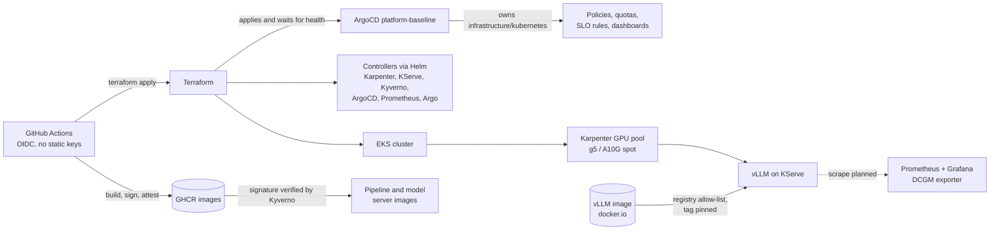

# GPU Inference Platform on AWS EKS

An LLM inference platform on EKS, being built to measure what serving costs and how it
behaves on spot GPUs: Karpenter-provisioned A10G nodes, vLLM on KServe, GPU and
request telemetry, and a signed, policy-enforced supply chain. Everything runs in
short burst sessions on one AWS account and is torn down the same day.

[](https://github.com/judeoyovbaire/mlops-platform/actions/workflows/ci-cd.yaml)

## Results

No GPU results are published yet. The first benchmark session will fill this table
from `scripts/benchmark/llm_bench.py`; raw output lands in
[`examples/llm-inference/results/`](examples/llm-inference/results/).

| Model | Precision | Instance | TTFT p50 / p95 | Output tok/s | $ per 1M tokens |
|---|---|---|---|---|---|
| Qwen2.5-7B-Instruct | bf16 | g5.xlarge spot | pending | pending | pending |
| Qwen2.5-7B-Instruct-AWQ | AWQ 4-bit | g5.xlarge spot | pending | pending | pending |

## What is proven today

The platform's first serving loop was run end to end on EKS in July 2026: a CI
dispatch builds the cluster, a training pipeline registers a model, CI deploys it
to KServe through Kyverno admission, and a metric-gated analysis rolls back a
degraded version automatically.

- [Deployment retrospective](docs/retros/aws-deploy-retro-2026-07.md): 38 defects
  found and fixed through the pipeline, and the green rebuild run.
- [ADR-016](docs/adr/016-rawdeployment-canary-and-observability.md): why the
  rollback is post-deploy verification, not traffic splitting, under KServe
  RawDeployment.
- [Rollback evidence](docs/evidence/): the AnalysisRun and the error-rate timeline
  from the live demonstration.

That loop (sklearn pipeline, MLflow registry, MLServer) stays until the vLLM path
has its own evidence, then leaves ([ADR-017](docs/adr/017-pivot-to-llm-inference-on-eks.md)).
The earlier multi-cloud version is preserved at tag
[`v1-classic-mlops`](https://github.com/judeoyovbaire/mlops-platform/tree/v1-classic-mlops).

## Architecture



| Layer | What runs | Where it is defined |
|---|---|---|
| Cluster | EKS, VPC, RDS, S3, KMS, IRSA roles | `infrastructure/terraform/modules/eks` |
| Platform | Helm releases, namespaces, Karpenter pools, Kyverno policies | `infrastructure/terraform/modules/aws-platform` |
| Baseline | Governance and network policies, quotas, PDBs, SLO rules, dashboards | `infrastructure/kubernetes`, synced by ArgoCD |
| Serving | vLLM InferenceServices, benchmark harness | `examples/llm-inference`, `scripts/benchmark` |
| Supply chain | Build, keyless signing, provenance, scanners | `.github/workflows` |

## Security posture

What is enforced:

- In the `mlops` and `argo` namespaces, images under
  `ghcr.io/judeoyovbaire/mlops-platform/*` must carry a keyless Cosign signature
  from this repository's build workflow on `main`
  ([ADR-008](docs/adr/008-supply-chain-security.md)). Builds attach SLSA v1
  Build L2 provenance.
- Third-party images, including vLLM, are limited to an allow-listed set of
  registries. They are not signature-verified.
- CI authenticates to AWS with OIDC; pods use IRSA. There are no static AWS
  credentials.
- No platform UI is exposed through a load balancer; access is by
  `kubectl port-forward`.
- Trivy and Checkov fail CI on new infrastructure findings; `main` requires all
  checks to pass through a pull request.

Known gaps, tracked openly:

- NetworkPolicies are written but not enforced: the VPC CNI network policy agent
  is not enabled yet.
- In-cluster access to MLflow is unauthenticated until MLflow is removed.
- Dependency CVE gates (image scan, pip-audit) report but do not block yet.

## Run a session

Prerequisites: an AWS account you control, AWS CLI, Terraform 1.14, kubectl,
Helm, and a spot quota for G-family instances (see
[`examples/llm-inference`](examples/llm-inference/README.md)).

```bash
# One-time: state bucket, lock table and GitHub OIDC role.
# Follow infrastructure/terraform/bootstrap/aws/README.md (fresh accounts differ).

# Each session: build, use, tear down
make deploy-aws                # EKS, controllers, ArgoCD baseline
make port-forward-grafana      # http://localhost:3000
kubectl apply -f examples/llm-inference/kserve-vllm.yaml
make destroy-aws               # same day
```

Infracost estimates the cost of pull requests that change Terraform. Teardown is
covered in [docs/runbooks/teardown.md](docs/runbooks/teardown.md).

## Repository layout

```
infrastructure/terraform   bootstrap/aws, environments/aws/dev, modules/{eks,aws-platform}
infrastructure/kubernetes  the ArgoCD-synced baseline
infrastructure/helm        Helm values for AWS and shared charts
examples/                  llm-inference, kserve
pipelines/, components/    classic training loop and transformer (leaving with MLflow)
docs/                      ADRs, retro, evidence, runbooks
```

## Roadmap

1. GPU observability that works: DCGM on the Karpenter pool, vLLM metrics scraped.
2. Benchmark results in the table above, with cost per million tokens.
3. Autoscaling on inference load (queue depth), with the scale-out on record.
4. Weight supply chain: weights pinned and hashed in S3, egress to the Hub blocked.
5. Inference-aware routing with the Gateway API Inference Extension.
6. Training side: Kueue and a LoRA job with checkpointing.

Decisions and their reasoning are in [docs/adr](docs/adr/README.md).

## License

MIT. Author: Jude Oyovbaire.
