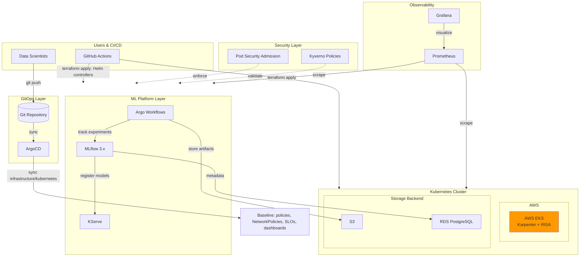

# Architecture Deep Dive

## Overview

An LLM inference platform on **AWS EKS** (ADR-017): Karpenter GPU spot pools, vLLM on KServe, and GPU cost observability. The classic sklearn/MLflow serving loop remains until the vLLM benchmark results are committed.

## System Architecture



## Layered Design

The platform separates the Kubernetes layer from the AWS layer:

```
┌─────────────────────────────────────────────────────────────────────────────┐
│                         Application Layer (Kubernetes)                      │
│  ┌──────────────┐  ┌──────────────┐  ┌──────────────┐  ┌──────────────┐     │
│  │    MLflow    │  │   KServe     │  │    Argo      │  │   ArgoCD     │     │
│  │   Tracking   │  │   Serving    │  │  Workflows   │  │    GitOps    │     │
│  └──────────────┘  └──────────────┘  └──────────────┘  └──────────────┘     │
├─────────────────────────────────────────────────────────────────────────────┤
│                         Platform Layer (Kubernetes)                         │
│  ┌──────────────┐  ┌──────────────┐  ┌──────────────┐  ┌──────────────┐     │
│  │  Prometheus  │  │   Kyverno    │  │   External   │  │ cert-manager │     │
│  │   Grafana    │  │   Policies   │  │   Secrets    │  │     TLS      │     │
│  └──────────────┘  └──────────────┘  └──────────────┘  └──────────────┘     │
├─────────────────────────────────────────────────────────────────────────────┤
│                         Infrastructure Layer (AWS)                          │
│                                                                             │
│  AWS EKS                                                                    │
│  ──────────────────────────                                                 │
│  • Karpenter (GPU scaling)                                                  │
│  • AWS Load Balancer Controller (installed, no Ingress objects)             │
│  • S3 + RDS PostgreSQL                                                      │
│  • IRSA (pod identity)                                                      │
│  • Secrets Manager                                                          │
│  • ECR repo (unused; images are on GHCR)                                    │
│                                                                             │
└─────────────────────────────────────────────────────────────────────────────┘
```

## Core Components

### 1. Argo Workflows

Argo Workflows orchestrates ML workflows as directed acyclic graphs (DAGs). Each step in a pipeline runs as a container, enabling reproducibility and scalability.

**Key Features:**
- Kubernetes-native workflow engine
- DAG and step-based workflow definitions
- Artifact passing between steps
- Caching and memoization for faster iteration
- Integration with MLflow for experiment tracking

```yaml
# Example workflow structure
apiVersion: argoproj.io/v1alpha1
kind: Workflow
metadata:
  name: ml-training-pipeline
spec:
  entrypoint: ml-pipeline
  templates:
    - name: ml-pipeline
      dag:
        tasks:
          - name: data-ingestion
          - name: data-validation
            dependencies: [data-ingestion]
          - name: feature-engineering
            dependencies: [data-validation]
          - name: model-training
            dependencies: [feature-engineering]
          - name: model-evaluation
            dependencies: [model-training]
```

### 2. MLflow 3.x

MLflow provides the experiment tracking and model registry capabilities.

**Components:**
- **Tracking Server**: Logs parameters, metrics, and artifacts
- **Model Registry**: Central repository for model versions with aliases
- **Backend Store**: PostgreSQL for metadata (RDS)
- **Artifact Store**: Object storage (S3)

**New in MLflow 3.x:**
- Model aliases replace deprecated staging workflow
- Native GenAI/LLM support (prompt versioning, agent tracing)
- Model Context Protocol (MCP) server integration

**Architecture:**
```
┌─────────────────┐     ┌──────────────┐
│  Training Job   │────▶│ MLflow Server│
└─────────────────┘     └──────┬───────┘
                               │
                  ┌────────────┴────────────┐
                  │                         │
            ┌─────▼─────┐           ┌───────▼───────┐
            │ RDS       │           │  S3 Bucket    │
            │ PostgreSQL│           │  (artifacts)  │
            └───────────┘           └───────────────┘
```

### 3. KServe

KServe (CNCF Incubating) handles model serving with advanced deployment strategies. It replaced Seldon Core due to licensing changes (Seldon moved to BSL 1.1 in Jan 2024).

**Features:**
- RawDeployment mode (no Knative required)
- Post-deploy verification with automated rollback (ADR-016); `canaryTrafficPercent` is ignored in RawDeployment
- Native support for sklearn, PyTorch, TensorFlow, vLLM
- MLflow model integration
- Autoscaling with HPA

**Rollback flow** (ADR-016, [scripts/demo](../scripts/demo/README.md)):
1. Deploy the challenger by patching the InferenceService `storageUri` (a full in-place rollout).
2. `scripts/demo/run-canary-analysis.py` runs the `ml-model-canary-analysis` AnalysisTemplate as a standalone AnalysisRun against live traffic.
3. On a Failed verdict it patches `storageUri` back to the champion (`--rollback-uri`).

### 4. LLM Inference with vLLM

The platform includes support for LLM inference using vLLM on GPU nodes:

**Features:**
- PagedAttention for efficient memory management
- Continuous batching for high throughput
- OpenAI-compatible API endpoints
- GPU nodes scale to zero via Karpenter consolidation; the InferenceService itself keeps at least one replica (RawDeployment has no scale-to-zero)

**Deployment:** [`examples/llm-inference/kserve-vllm.yaml`](../examples/llm-inference/kserve-vllm.yaml) runs `vllm/vllm-openai:v0.11.0` with two configurations, each sized for one g5.xlarge (A10G 24GB):

| InferenceService | Model | Precision |
|------------------|-------|-----------|
| `llm-qwen-bf16` | `Qwen/Qwen2.5-7B-Instruct` | bfloat16 |
| `llm-qwen-awq` | `Qwen/Qwen2.5-7B-Instruct-AWQ` | 4-bit AWQ |

Both models are pinned to Hub commit SHAs (`--revision`).

### 5. HuggingFace Pretrained Model Pipeline

In addition to training from scratch, the platform supports deploying pretrained models from HuggingFace Hub — a pattern used by many production teams who fine-tune or deploy existing models rather than training from scratch.

**Pipeline Steps:**
1. **Fetch Model** — Downloads model + tokenizer from HuggingFace Hub, runs sanity inference
2. **Register Model** — Logs model to MLflow using `mlflow.transformers.log_model()`, sets alias

**Serving:** KServe's native HuggingFace runtime (`modelFormat: huggingface`) serves models directly, handling tokenization and inference with no custom code.

**Default Model:** `distilbert/distilbert-base-uncased-finetuned-sst-2-english` (sentiment analysis, ~260MB, CPU-only). The pipeline is parameterized so any HF model can be swapped in via workflow parameters.

### 6. GPU Autoscaling

**AWS: Karpenter**

Karpenter provides just-in-time node provisioning for GPU and training workloads:

- Faster node provisioning than Cluster Autoscaler
- Native SPOT instance support (the GPU and training pools are spot-only)
- Right-sizing: Provisions optimal instance types automatically
- Consolidation: Removes underutilized nodes to reduce costs

**NodePools Configured:**

| NodePool | Instance Types | Capacity | Taints |
|----------|---------------|----------|--------|
| gpu-workloads | g5 only (expireAfter 4h, limit 2 GPUs) | SPOT only | `nvidia.com/gpu=true:NoSchedule` |
| training-workloads | c, m, r (xlarge-4xlarge) | SPOT only | `workload=training:NoSchedule` |
| general-workloads | m, c, r (large-2xlarge) | on-demand + SPOT | none |

### 7. GitOps with ArgoCD

Terraform installs the platform's controllers with Helm. ArgoCD owns everything under `infrastructure/kubernetes/` (governance policies, network policies, quotas, PDBs, SLO rules, dashboards, rollout templates, Argo Events) through the `platform-baseline` Application, with automated sync, prune and self-heal (ADR-017 decision 6). Terraform applies that Application and waits for it to be Synced and Healthy before installing MLflow and MinIO. Model deployments are still pushed by CI (`reusable-deploy-model.yaml`), not synced from Git.

## Cloud Providers

The platform runs on AWS:

| Cloud | Module         | Status             | Key Services                            |
|-------|----------------|--------------------|-----------------------------------------|
| AWS   | `modules/eks`  | **Verified (dev)**   | EKS, S3, RDS, IRSA                    |

## Infrastructure

### AWS Infrastructure

**Terraform Structure:**
```
infrastructure/terraform/
├── bootstrap/aws/         # AWS prerequisites (state bucket, KMS, locks, GitHub OIDC)
├── environments/aws/dev/  # Root module
│   ├── eks.tf             # modules/eks instantiation
│   ├── platform.tf        # modules/aws-platform instantiation
│   ├── secrets.tf         # Secrets Manager entries, SSM cluster params
│   └── providers.tf       # AWS, Kubernetes, Helm, kubectl providers
├── modules/eks/           # AWS layer
│   ├── main.tf            # VPC, EKS cluster, managed node groups
│   ├── storage.tf         # S3 buckets
│   ├── database.tf        # RDS PostgreSQL for MLflow
│   ├── iam.tf             # IRSA roles
│   ├── karpenter.tf       # Karpenter controller and node IAM
│   ├── kms.tf, backup.tf, ecr.tf, vpc-flow-logs.tf
│   └── ...
└── modules/aws-platform/  # Kubernetes layer (ADR-015)
    ├── helm-core.tf       # ALB controller, cert-manager, ArgoCD, KServe, MLflow, Argo Workflows, MinIO
    ├── monitoring.tf      # Prometheus stack, Loki, Tempo, OTel Collector, Alloy
    ├── kyverno.tf, karpenter.tf, gitops-baseline.tf
    └── ...
```

**Managed Node Groups:**
- **General**: Platform services (t3.large x2, ON_DEMAND)
- **Training**: c5.2xlarge, SPOT, 0-5
- **GPU**: g4dn.xlarge, SPOT, 0-2 (dormant, desired 0). GPU serving uses the Karpenter g5 pool, not this node group.

Module reference: [`modules/eks/README.md`](../infrastructure/terraform/modules/eks/README.md).

**AWS Resources Created:**
- VPC with public/private subnets across 3 AZs
- EKS cluster with managed node groups
- S3 bucket for MLflow artifacts
- RDS PostgreSQL for MLflow metadata
- IAM roles with IRSA for secure pod authentication (full SA-to-role mapping: [IRSA access matrix](irsa-access-matrix.md))
- AWS Load Balancer Controller installed; no Ingress objects are created (UIs reached by port-forward)
- VPC Flow Logs with CloudWatch integration
- AWS Backup vault with daily/weekly backup plans

### Helm Releases (via Terraform)

The platform deploys these components:

| Component                    | AWS Chart                                |
|------------------------------|------------------------------------------|
| Ingress                      | eks-charts/aws-load-balancer-controller  |
| cert-manager                 | jetstack/cert-manager                    |
| ArgoCD                       | argo/argo-cd                             |
| KServe CRDs                  | kserve/kserve-crd                        |
| KServe Controller            | kserve/kserve                            |
| MLflow                       | community-charts/mlflow                  |
| Argo Workflows               | argo/argo-workflows                      |
| Prometheus Stack             | prometheus-community/kube-prometheus-stack |
| Loki                         | grafana/loki                             |
| Tempo                        | grafana-community/tempo                  |
| OpenTelemetry Collector      | open-telemetry/opentelemetry-collector   |
| External Secrets             | external-secrets/external-secrets        |
| Kyverno                      | kyverno/kyverno                          |
| GPU Autoscaling              | karpenter/karpenter                      |
| Argo Rollouts (AnalysisRuns) | argo/argo-rollouts                       |
| Argo Events                  | argo/argo-events                         |
| MinIO                        | minio/minio                              |
| OpenCost                     | opencost/opencost                        |
| DCGM Exporter                | dcgm-exporter/dcgm-exporter              |
| Alloy                        | grafana/alloy                            |
| NVIDIA Device Plugin         | nvidia/nvidia-device-plugin              |

## Data Flow

```
┌─────────┐    ┌──────────┐    ┌─────────┐    ┌──────────┐    ┌────────┐
│  Data   │───▶│ Validate │───▶│ Train   │───▶│ Register │───▶│ Serve  │
│ Source  │    │   Data   │    │ Model   │    │  Model   │    │ Model  │
└─────────┘    └──────────┘    └─────────┘    └──────────┘    └────────┘
     │              │               │              │               │
     └──────────────┴───────────────┴──────────────┴───────────────┘
                              │
                    ┌─────────▼────────────┐
                    │     Observability    │
                    │ (Prometheus/Grafana) │
                    └──────────────────────┘
```

## Infrastructure Layers

### Layer 1: Cloud Infrastructure
**AWS:**
- VPC with public/private subnets
- EKS cluster with managed node groups
- RDS PostgreSQL for MLflow
- S3 for artifact storage
- No public service endpoints (UIs via port-forward). The EKS API endpoint is public (`0.0.0.0/0`, IAM-authenticated) because CI runs on GitHub-hosted runners (`environments/aws/dev/variables.tf`)

### Layer 2: Platform Services
- AWS Load Balancer Controller (installed; no Ingress objects)
- cert-manager for TLS
- Prometheus/Grafana for monitoring
- External Secrets Operator

### Layer 3: ML Platform
- Argo Workflows
- MLflow 3.x
- KServe (RawDeployment mode)
- ArgoCD for GitOps

### Layer 4: Applications
- Training pipelines
- Inference services
- Monitoring dashboards

## Security Architecture

The platform implements defense-in-depth security across multiple layers:

```
┌─────────────────────────────────────────────────────────────────────────────┐
│                         Security Architecture                               │
├─────────────────────────────────────────────────────────────────────────────┤
│                                                                             │
│  ┌─────────────────┐  ┌──────────────────┐  ┌────────────────────────────┐  │
│  │ Pod Security    │  │ Policy Engine    │  │ Supply Chain               │  │
│  │ Standards (PSA) │  │ (Kyverno)        │  │ (Cosign + Kyverno)         │  │
│  ├─────────────────┤  ├──────────────────┤  ├────────────────────────────┤  │
│  │ Enforces:       │  │ Validates:       │  │ Verifies at admission:     │  │
│  │ - baseline mode │  │ - Resource limits│  │ - Keyless signature        │  │
│  │ - restricted    │  │ - Image tags     │  │ - Repo-pinned identity     │  │
│  │   (audit/warn)  │  │ - Registries     │  │ - Immutable image tags     │  │
│  │                 │  │ - Labels         │  │ - Signed by digest in CI   │  │
│  └─────────────────┘  └──────────────────┘  └────────────────────────────┘  │
│                                                                             │
└─────────────────────────────────────────────────────────────────────────────┘
```

### Pod Security Standards (PSA)

Native Kubernetes pod security using namespace labels (`modules/aws-platform/namespaces.tf`, `monitoring.tf`, `kyverno.tf`):

| Namespace | Enforce Level | Warn Level | Audit Level | Rationale |
|-----------|---------------|------------|-------------|-----------|
| `mlops` | baseline | baseline | restricted | KServe runtime images don't set seccompProfile |
| `mlflow` | baseline | baseline | restricted | MLflow chart doesn't set seccompProfile |
| `kserve` | **restricted** | restricted | restricted | Model serving controller |
| `argo` | baseline | baseline | restricted | Pipeline executor needs elevated perms |
| `monitoring` | privileged | privileged | privileged | Node-exporter needs hostPath |
| `kyverno` | privileged | - | - | Admission controller |

### Kyverno Policy Engine

Kubernetes-native policy engine (CNCF Incubating) providing policy-as-code:

**Cluster Policies:**

| Policy | Scope | Action | Purpose |
|--------|-------|--------|---------|
| `require-resource-limits` | mlops, mlflow, argo, kserve | Enforce | Prevent resource exhaustion |
| `disallow-latest-tag` | mlops, kserve | Enforce | Ensure reproducibility |
| `restrict-image-registries` | mlops, kserve | Enforce | Supply chain security |
| `disallow-privileged-containers` | mlops, mlflow, argo, kserve | Enforce | No privileged pods |
| `require-mlops-labels` | mlops | Audit | Model traceability |
| `add-default-networkpolicy` | New namespaces | Generate | Default-deny ingress (no effect until enforcement is on, see below) |

These are applied by Terraform (`modules/aws-platform/kyverno.tf`). ArgoCD syncs the governance set from `infrastructure/kubernetes/governance/`: `verify-image-signatures` (Enforce), `audit-unsigned-images` (Audit), `require-immutable-image-tags` (Enforce), and the model-registry policies (`require-model-metadata`, `require-model-lineage`, `enforce-semantic-versioning`, `require-production-approval`, `require-model-metrics`, `protect-production-models`, all Enforce; `generate-model-audit-log` generates).

### Pod Identity

**AWS: IRSA (IAM Roles for Service Accounts)**
- Pod-level IAM roles
- No static credentials
- Automatic credential rotation

### Security Layers

```
┌───────────────────────────────────────────────────────────────┐
│                    Security Layers                            │
├───────────────────────────────────────────────────────────────┤
│  Network Policies      │  Pod Security    │  RBAC             │
│  ─────────────────     │  ─────────────   │  ──────           │
│  - Namespace isolation │  - Non-root      │  - Role per       │
│  - Ingress/Egress      │  - Read-only FS  │    namespace      │
│  - VPC security groups │  - Capabilities  │  - Least          │
│  - Kyverno auto-gen    │  - PSA labels    │    privilege      │
├───────────────────────────────────────────────────────────────┤
│  Pod Identity          │  Image Security  │  Supply Chain     │
│  ─────────────────     │  ──────────────  │  ─────────────    │
│  - IRSA (AWS)          │  - Kyverno       │  - Cosign keyless │
│                        │    registry      │  - Repo-pinned    │
│  - No static creds     │    allowlist     │    identity       │
│                        │  - No :latest    │  - SLSA Build L2  │
└───────────────────────────────────────────────────────────────┘
```

**NetworkPolicies are not enforced today.** The VPC CNI network policy agent is off (`enableNetworkPolicy` is unset in `modules/eks/main.tf`). The policies are written and synced by ArgoCD but have no effect until it is enabled.

## Observability

### Network Observability

The platform provides network visibility through VPC Flow Logs:

**AWS: VPC Flow Logs**
```hcl
resource "aws_flow_log" "main" {
  vpc_id                   = module.vpc.vpc_id
  traffic_type             = "ALL"
  log_destination_type     = "cloud-watch-logs"
  log_destination          = aws_cloudwatch_log_group.flow_logs.arn
  max_aggregation_interval = 60  # 1-minute granularity
}
```

Flow logs are stored in CloudWatch with configurable retention (default: 30 days) and can be analyzed using CloudWatch Logs Insights for:
- Network traffic patterns
- Security incident investigation
- Connection troubleshooting
- Compliance auditing

### Cost Dashboard

A comprehensive Grafana dashboard for cloud cost monitoring is included:

**Dashboard Panels:**
| Panel | Metric | Description |
|-------|--------|-------------|
| Estimated Monthly Cost | `sum(opencost_pod_cost_total) * 730` | Projected monthly spend |
| Cost by Namespace | `sum by (namespace) (opencost_pod_cost_total)` | Breakdown by team/project |
| CPU Efficiency | Usage ÷ Requests | Optimization opportunities |
| Memory Efficiency | Usage ÷ Requests | Over-provisioning detection |
| GPU Utilization | `DCGM_FI_DEV_GPU_UTIL` | GPU cost optimization |
| Resource Waste | Requests - Usage | Wasted capacity costs |

**Location:** `infrastructure/kubernetes/dashboards/cloud-cost-dashboard.yaml`

Panels query OpenCost metrics (`opencost_pod_cost_total`, `opencost_node_cost_total`) from the OpenCost release (`modules/aws-platform/cost-observability.tf`); pricing comes from OpenCost, not constants.

### Observability Stack Security

All observability components run with hardened security contexts:
- **Loki, Tempo, OTel Collector**: `runAsNonRoot`, `readOnlyRootFilesystem`, `drop ALL` capabilities
- **Alloy (log shipper)**: Runs as root (`runAsUser: 0`) — required for reading host log files as a DaemonSet, but `privileged: false`

### Prometheus Monitoring

The platform includes scrape configuration for metrics collection:

```yaml
# infrastructure/kubernetes/monitoring.yaml
- ServiceMonitor: mlflow                     # MLflow tracking server
- ScrapeConfig: kserve-inference             # MLServer metrics on :8082
- ServiceMonitor: argo-workflows-controller  # Pipeline runs
```

### Alerting Rules

The `mlops-alerts` PrometheusRule in `infrastructure/kubernetes/monitoring.yaml` defines 18 alerts, including `HighInferenceLatency`, `HighInferenceErrorRate`, `MLflowDown`, `HighWorkflowFailureRate` and `LowGPUUtilization`. See that file for the full list and thresholds.

### Grafana Dashboard

A pre-built dashboard is included as a ConfigMap:
- Inference requests/sec
- P95 latency by model
- Active models count
- Error rate percentage
- Request rate by model

## Scalability Considerations

### Horizontal Scaling
As configured today:
- Argo Workflows: one controller replica
- MLflow: one replica, ClusterIP service
- KServe: RawDeployment HPA on CPU (the default)

### GPU Resource Management
```yaml
# infrastructure/kubernetes/resource-quotas.yaml (excerpt)
apiVersion: v1
kind: ResourceQuota
metadata:
  name: mlops-quota
  namespace: mlops
spec:
  hard:
    requests.nvidia.com/gpu: "4"
    limits.nvidia.com/gpu: "4"
```

### Cost Optimization
- SPOT instances for training and GPU nodes
- Training and GPU capacity scales to zero (managed node groups at desired 0, Karpenter consolidation)
- Single NAT gateway for dev
- Resource requests/limits enforcement

## Deployment Workflow

### AWS Deployment

```bash
# Deploy entire platform (~15-20 minutes)
make deploy-aws

# Check status
make status-aws

# Destroy when done
make destroy-aws
```

### Manual Terraform

```bash
# AWS
make terraform-init-aws
make terraform-plan-aws
make terraform-apply-aws

# Port forward services
make port-forward-mlflow   # localhost:5000
make port-forward-argocd   # localhost:8080
```

### CI/CD Flow

```
Push / pull request to main
    │
    ├── lint-python (uv ruff, bandit 1.8.3)
    ├── validate-terraform
    ├── validate-kubernetes (kubeconform)
    ├── test-policies (Kyverno)
    ├── validate-helm
    ├── security-scan (Trivy), checkov-scan, scan-container-images
    ├── test-python, test-property, validate-optional-deps
    ├── terraform-plan-aws
    └── e2e-test (Kind; schedule, dispatch, or the e2e-test PR label)

workflow_dispatch: deploy-infra-aws (action=deploy-infra), deploy-model-aws (action=deploy-model)
```

## External Access

### AWS: no public endpoints

No platform UI is exposed through a load balancer. The internet-facing ALBs in front of MLflow, Grafana and ArgoCD were removed in November 2026 (MLflow had no authentication and sat inside CVE-2026-64849). Access is by `kubectl port-forward` through the Makefile targets:

| Service | Ingress Class | Access |
|---------|--------------|--------|
| ArgoCD | none | cluster-internal, `make port-forward-argocd` |
| MLflow | none | cluster-internal, `make port-forward-mlflow` |

### Port Forwarding (Development)

For local development or when external access is not needed:
```bash
make port-forward-mlflow   # MLflow at localhost:5000
make port-forward-argocd   # ArgoCD at localhost:8080
make port-forward-grafana  # Grafana at localhost:3000
```

## Model Governance

The platform enforces model governance through Kyverno policies that ensure:

**Required Model Metadata:**
- Model name, version, and owner labels
- Model stage (staging/production/archived)
- MLflow experiment and run ID for lineage tracking

**Production Approval Workflow:**
- Models must have approval annotations before production deployment
- Approver identity and approval ticket required
- Production models protected from accidental deletion

**Semantic Versioning:**
- All models validated against semver format (X.Y.Z)
- Automatic audit log generation for deployments

See [governance policies](../infrastructure/kubernetes/governance/) for implementation details.

## Data Drift Monitoring (Descoped)

Drift-triggered retraining was **descoped** — see
[ADR-013](adr/013-descope-drift-triggered-retraining.md). The statistical
core (Kolmogorov-Smirnov, PSI, Jensen-Shannon, chi-squared/Cramér's V) is
retained as a standalone, property-tested library in
[components/drift-detection/](../components/drift-detection/); it is not
deployed. Integration requires production inference-data capture first and
can be revisited once real traffic exists.

## Component Versions

Current versions deployed by the platform:

| Component | Version | Notes |
|-----------|---------|-------|
| Kubernetes | 1.37 | EKS (1.36 is the fallback) |
| MLflow | 3.16.0 (chart 1.11.7) | Helm chart with S3 artifacts, RDS backend |
| KServe | 0.16.0 | CNCF Incubating, RawDeployment mode |
| Argo Workflows | 0.47.3 (chart) | ML pipeline execution engine |
| Argo Rollouts | 2.39.1 (chart) | AnalysisRun engine only (ADR-016) |
| Argo Events | 2.4.14 (chart) | Event bus |
| Karpenter (AWS) | 1.15.1 | GPU autoscaling with SPOT support |
| ArgoCD | 10.11.6 | Chart deploys Argo CD v3.5.6 |
| AWS ALB Controller | 1.17.1 | Installed; no Ingress objects created |
| cert-manager | 1.21.3 | TLS certificate management |
| Prometheus Stack | 92.17.0 | Monitoring and alerting (Grafana 13) |
| Loki | 6.55.0 | Log aggregation (hardened securityContext); last OSS chart in grafana/helm-charts |
| Tempo | 2.4.0 | Distributed tracing, grafana-community chart (Tempo 2.10) |
| OpenTelemetry Collector | 0.178.1 | Unified telemetry pipeline (hardened securityContext) |
| External Secrets | 2.14.0 | Secrets Manager (`ClusterSecretStore aws-sm`) |
| Kyverno | 3.9.2 (v1.19.2) | Policy engine; held below 1.20, which rejects new ClusterPolicy objects |
| MinIO | 5.4.0 | S3-compatible object storage (Argo artifacts) |
| OpenCost | 2.5.33 (chart) | Cost metrics |
| DCGM Exporter | 4.8.4 (chart) | GPU metrics |
| Alloy | 1.15.0 (chart) | Log shipper |
| NVIDIA Device Plugin | 0.20.1 (chart) | Exposes `nvidia.com/gpu` |
| vLLM | v0.11.0 | High-throughput LLM inference |

On Kubernetes 1.37 only External Secrets 2.14 is officially tested upstream. cert-manager 1.21 lists 1.33-1.36 and Kyverno 1.19 lists 1.33-1.35; no newer release exists (inside the Kyverno cap), so the first 1.37 session is their test. 1.36 is the fallback.

## Design Decisions I'd Revisit

Documented for transparency — these are decisions I'd evaluate differently in a greenfield build.

### 1. Terragrunt for DRY Configuration

Resolved without Terragrunt: [ADR-015](adr/015-shared-aws-platform-module.md) moved the
platform layer into one shared `aws-platform` module, superseding the Terragrunt evaluation
in [ADR-012](adr/012-terragrunt-evaluation.md), and [ADR-017](adr/017-pivot-to-llm-inference-on-eks.md)
removed the other clouds, so per-environment duplication is limited to thin root modules.

### 2. Gateway API over Ingress

There are no Ingress objects. The ALB controller is installed but unused, and UIs are reached
by port-forward. Gateway API (Inference Extension) is the planned routing layer (roadmap item 5).

### 3. KServe Transformer for Preprocessing

The `build_serving_model.py` step bundles a ColumnTransformer into an MLflow pyfunc model.
A transformer exists (`components/kserve-transformer`, built and signed in CI,
`examples/kserve/transformer-inferenceservice.yaml`), but CI still deploys the bundled-pyfunc
champion. Both leave with the classic loop.
