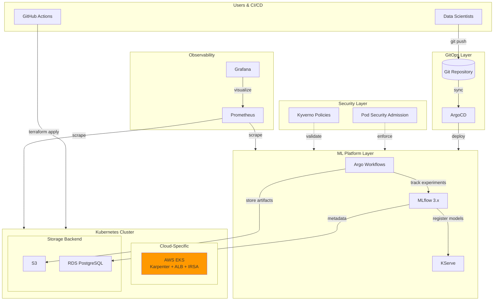

# Architecture Deep Dive

## Overview

The MLOps Platform is designed to provide a complete ML lifecycle management solution on **AWS EKS**. It follows cloud-native principles and enables teams to build, train, deploy, and monitor ML models at scale.

## System Architecture



## Layered Design

The platform uses a layered architecture that separates cloud-agnostic components from AWS-native services:

```
┌─────────────────────────────────────────────────────────────────────────────┐
│                         Application Layer (Cloud-Agnostic)                  │
│  ┌──────────────┐  ┌──────────────┐  ┌──────────────┐  ┌──────────────┐     │
│  │    MLflow    │  │   KServe     │  │    Argo      │  │   ArgoCD     │     │
│  │   Tracking   │  │   Serving    │  │  Workflows   │  │    GitOps    │     │
│  └──────────────┘  └──────────────┘  └──────────────┘  └──────────────┘     │
├─────────────────────────────────────────────────────────────────────────────┤
│                         Platform Layer (Cloud-Agnostic)                     │
│  ┌──────────────┐  ┌──────────────┐  ┌──────────────┐  ┌──────────────┐     │
│  │  Prometheus  │  │   Kyverno    │  │   External   │  │ cert-manager │     │
│  │   Grafana    │  │   Policies   │  │   Secrets    │  │     TLS      │     │
│  └──────────────┘  └──────────────┘  └──────────────┘  └──────────────┘     │
├─────────────────────────────────────────────────────────────────────────────┤
│                         Infrastructure Layer (AWS)                          │
│                                                                             │
│  AWS EKS                                                                    │
│  ──────────────────────────                                                 │
│  • Karpenter (GPU scaling)                                                  │
│  • ALB Ingress Controller                                                   │
│  • S3 + RDS PostgreSQL                                                      │
│  • IRSA (pod identity)                                                      │
│  • Secrets Manager                                                          │
│  • ECR (registry)                                                           │
│                                                                             │
└─────────────────────────────────────────────────────────────────────────────┘
```

## Core Components

### 1. Argo Workflows

Argo Workflows orchestrates ML workflows as directed acyclic graphs (DAGs). Each step in a pipeline runs as a container, enabling reproducibility and scalability.

**Key Features:**
- Kubernetes-native workflow engine
- DAG and step-based workflow definitions
- Artifact passing between steps
- Caching and memoization for faster iteration
- Integration with MLflow for experiment tracking

```yaml
# Example workflow structure
apiVersion: argoproj.io/v1alpha1
kind: Workflow
metadata:
  name: ml-training-pipeline
spec:
  entrypoint: ml-pipeline
  templates:
    - name: ml-pipeline
      dag:
        tasks:
          - name: data-ingestion
          - name: data-validation
            dependencies: [data-ingestion]
          - name: feature-engineering
            dependencies: [data-validation]
          - name: model-training
            dependencies: [feature-engineering]
          - name: model-evaluation
            dependencies: [model-training]
```

### 2. MLflow 3.x

MLflow provides the experiment tracking and model registry capabilities.

**Components:**
- **Tracking Server**: Logs parameters, metrics, and artifacts
- **Model Registry**: Central repository for model versions with aliases
- **Backend Store**: PostgreSQL for metadata (RDS)
- **Artifact Store**: Object storage (S3)

**New in MLflow 3.x:**
- Model aliases replace deprecated staging workflow
- Native GenAI/LLM support (prompt versioning, agent tracing)
- Model Context Protocol (MCP) server integration

**Architecture:**
```
┌─────────────────┐     ┌──────────────┐
│  Training Job   │────▶│ MLflow Server│
└─────────────────┘     └──────┬───────┘
                               │
                  ┌────────────┴────────────┐
                  │                         │
            ┌─────▼─────┐           ┌───────▼───────┐
            │ RDS       │           │  S3 Bucket    │
            │ PostgreSQL│           │  (artifacts)  │
            └───────────┘           └───────────────┘
```

### 3. KServe

KServe (CNCF Incubating) handles model serving with advanced deployment strategies. It replaced Seldon Core due to licensing changes (Seldon moved to BSL 1.1 in Jan 2024).

**Features:**
- RawDeployment mode (no Knative required)
- Canary deployments with traffic splitting
- Native support for sklearn, PyTorch, TensorFlow, vLLM
- MLflow model integration
- Autoscaling with HPA

**Deployment Example:**
```yaml
# Canary Deployment Configuration
apiVersion: serving.kserve.io/v1beta1
kind: InferenceService
metadata:
  name: sklearn-iris-canary
spec:
  predictor:
    canaryTrafficPercent: 10
    model:
      modelFormat:
        name: sklearn
      storageUri: s3://models/sklearn/iris
```

### 4. LLM Inference with vLLM

The platform includes support for LLM inference using vLLM on GPU nodes:

**Features:**
- PagedAttention for efficient memory management
- Continuous batching for high throughput
- OpenAI-compatible API endpoints
- Scale-to-zero for cost optimization

**Example Deployment:**
```yaml
apiVersion: serving.kserve.io/v1beta1
kind: InferenceService
metadata:
  name: llm-mistral
spec:
  predictor:
    containers:
      - name: kserve-container
        image: vllm/vllm-openai:v0.8.0
        args:
          - --model=mistralai/Mistral-7B-Instruct-v0.2
          - --max-model-len=4096
          - --gpu-memory-utilization=0.9
        resources:
          limits:
            nvidia.com/gpu: "1"
```

**Included Models:**

| Model               | Size | GPU Memory | Use Case        |
|---------------------|------|------------|-----------------|
| Mistral-7B-Instruct | 7B   | ~14GB      | General purpose |
| TinyLlama-1.1B      | 1.1B | ~4GB       | Testing, demos  |
| CodeLlama-7B        | 7B   | ~14GB      | Code generation |

### 5. HuggingFace Pretrained Model Pipeline

In addition to training from scratch, the platform supports deploying pretrained models from HuggingFace Hub — a pattern used by many production teams who fine-tune or deploy existing models rather than training from scratch.

**Pipeline Steps:**
1. **Fetch Model** — Downloads model + tokenizer from HuggingFace Hub, runs sanity inference
2. **Register Model** — Logs model to MLflow using `mlflow.transformers.log_model()`, sets alias

**Serving:** KServe's native HuggingFace runtime (`modelFormat: huggingface`) serves models directly, handling tokenization and inference with no custom code.

**Default Model:** `distilbert/distilbert-base-uncased-finetuned-sst-2-english` (sentiment analysis, ~260MB, CPU-only). The pipeline is parameterized so any HF model can be swapped in via workflow parameters.

### 6. GPU Autoscaling

**AWS: Karpenter**

Karpenter provides just-in-time node provisioning for GPU and training workloads:

- Faster node provisioning than Cluster Autoscaler
- Native SPOT instance support with fallback to on-demand
- Right-sizing: Provisions optimal instance types automatically
- Consolidation: Removes underutilized nodes to reduce costs

**NodePools Configured:**

| NodePool | Instance Types | Capacity | Taints |
|----------|---------------|----------|--------|
| gpu-workloads | g4dn, g5, p3, p4d | SPOT preferred | `nvidia.com/gpu=true:NoSchedule` |
| training-workloads | c5, m5, r5 (xlarge-4xlarge) | SPOT only | `workload=training:NoSchedule` |

### 6. GitOps with ArgoCD

Terraform installs the platform's controllers with Helm. ArgoCD owns everything under `infrastructure/kubernetes/` (governance policies, network policies, quotas, PDBs, SLO rules, dashboards, rollout templates, Argo Events) through the `platform-baseline` Application, with automated sync, prune and self-heal (ADR-017 decision 6). Terraform applies that Application and waits for it to be Synced and Healthy before installing MLflow and MinIO. Model deployments are still pushed by CI (`reusable-deploy-model.yaml`), not synced from Git.

## Cloud Providers

The platform runs on AWS:

| Cloud | Module         | Status             | Key Services                            |
|-------|----------------|--------------------|-----------------------------------------|
| AWS   | `modules/eks`  | **Verified (dev)**   | EKS, S3, RDS, ALB, IRSA               |

The Kubernetes layer (KServe, MLflow, ArgoCD) is cloud-agnostic.

## Infrastructure

### AWS Infrastructure

**Terraform Structure:**
```
infrastructure/terraform/
├── bootstrap/aws/       # AWS prerequisites (S3, GitHub OIDC)
├── modules/eks/         # AWS EKS module
│   ├── main.tf          # VPC, EKS cluster, node groups, S3, RDS, IRSA
│   ├── variables.tf     # Configurable inputs
│   └── outputs.tf       # Cluster endpoints, ARNs
└── environments/aws/dev/# Main deployment configuration
    ├── providers.tf     # AWS + Kubernetes providers
    ├── eks.tf           # EKS module instantiation
    ├── helm-core.tf     # Helm releases
    └── ...
```

**Node Groups:**
- **General**: Platform services (t3.large, ON_DEMAND)
- **Training**: ML training jobs (c5.2xlarge, SPOT, scale-to-zero)
- **GPU**: GPU workloads (g4dn.xlarge, SPOT, scale-to-zero)

**AWS Resources Created:**
- VPC with public/private subnets across 3 AZs
- EKS cluster with managed node groups
- S3 bucket for MLflow artifacts
- RDS PostgreSQL for MLflow metadata
- IAM roles with IRSA for secure pod authentication (full SA-to-role mapping: [IRSA access matrix](irsa-access-matrix.md))
- AWS Load Balancer Controller installed; no Ingress objects are created (UIs reached by port-forward)
- VPC Flow Logs with CloudWatch integration
- AWS Backup vault with daily/weekly backup plans

### Helm Releases (via Terraform)

The platform deploys these components:

| Component                    | AWS Chart                                |
|------------------------------|------------------------------------------|
| Ingress                      | eks-charts/aws-load-balancer-controller  |
| cert-manager                 | jetstack/cert-manager                    |
| ArgoCD                       | argo/argo-cd                             |
| KServe CRDs                  | kserve/kserve-crd                        |
| KServe Controller            | kserve/kserve                            |
| MLflow                       | community-charts/mlflow                  |
| Argo Workflows               | argo/argo-workflows                      |
| Prometheus Stack             | prometheus-community/kube-prometheus-stack |
| Loki                         | grafana/loki                             |
| Tempo                        | grafana/tempo                            |
| OpenTelemetry Collector      | open-telemetry/opentelemetry-collector   |
| External Secrets             | external-secrets/external-secrets        |
| Kyverno                      | kyverno/kyverno                          |
| GPU Autoscaling              | karpenter/karpenter                      |

## Data Flow

```
┌─────────┐    ┌──────────┐    ┌─────────┐    ┌──────────┐    ┌────────┐
│  Data   │───▶│ Feature  │───▶│ Train   │───▶│ Register │───▶│ Serve  │
│ Source  │    │  Store   │    │ Model   │    │  Model   │    │ Model  │
└─────────┘    └──────────┘    └─────────┘    └──────────┘    └────────┘
     │              │               │              │               │
     └──────────────┴───────────────┴──────────────┴───────────────┘
                              │
                    ┌─────────▼────────────┐
                    │     Observability    │
                    │ (Prometheus/Grafana) │
                    └──────────────────────┘
```

## Infrastructure Layers

### Layer 1: Cloud Infrastructure
**AWS:**
- VPC with public/private subnets
- EKS cluster with managed node groups
- RDS PostgreSQL for MLflow
- S3 for artifact storage
- No public endpoints (kubectl port-forward)

### Layer 2: Platform Services
- Ingress Controller (ALB)
- cert-manager for TLS
- Prometheus/Grafana for monitoring
- External Secrets Operator

### Layer 3: ML Platform
- Argo Workflows
- MLflow 3.x
- KServe (RawDeployment mode)
- ArgoCD for GitOps

### Layer 4: Applications
- Training pipelines
- Inference services
- Monitoring dashboards

## Security Architecture

The platform implements defense-in-depth security across multiple layers:

```
┌─────────────────────────────────────────────────────────────────────────────┐
│                         Security Architecture                               │
├─────────────────────────────────────────────────────────────────────────────┤
│                                                                             │
│  ┌─────────────────┐  ┌──────────────────┐  ┌────────────────────────────┐  │
│  │ Pod Security    │  │ Policy Engine    │  │ Supply Chain               │  │
│  │ Standards (PSA) │  │ (Kyverno)        │  │ (Cosign + Kyverno)         │  │
│  ├─────────────────┤  ├──────────────────┤  ├────────────────────────────┤  │
│  │ Enforces:       │  │ Validates:       │  │ Verifies at admission:     │  │
│  │ - baseline mode │  │ - Resource limits│  │ - Keyless signature        │  │
│  │ - restricted    │  │ - Image tags     │  │ - Repo-pinned identity     │  │
│  │   (audit/warn)  │  │ - Registries     │  │ - Immutable image tags     │  │
│  │                 │  │ - Labels         │  │ - Signed by digest in CI   │  │
│  └─────────────────┘  └──────────────────┘  └────────────────────────────┘  │
│                                                                             │
└─────────────────────────────────────────────────────────────────────────────┘
```

### Pod Security Standards (PSA)

Native Kubernetes pod security using namespace labels:

| Namespace | Enforce Level | Warn Level | Audit Level | Rationale |
|-----------|---------------|------------|-------------|-----------|
| `mlops` | **restricted** | restricted | restricted | ML inference workloads (hardened) |
| `mlflow` | **restricted** | restricted | restricted | Experiment tracking (stateless) |
| `kserve` | **restricted** | restricted | restricted | Model serving controller |
| `argo` | baseline | restricted | restricted | Pipeline executor needs elevated perms |
| `monitoring` | privileged | - | - | Node-exporter needs hostPath |
| `kyverno` | privileged | - | - | Admission controller |

### Kyverno Policy Engine

Kubernetes-native policy engine (CNCF Incubating) providing policy-as-code:

**Cluster Policies:**

| Policy | Scope | Action | Purpose |
|--------|-------|--------|---------|
| `require-resource-limits` | ML namespaces | Audit | Prevent resource exhaustion |
| `disallow-latest-tag` | mlops, kserve | Audit | Ensure reproducibility |
| `require-mlops-labels` | mlops | Audit | Model traceability |
| `restrict-image-registries` | mlops, kserve | Audit | Supply chain security |
| `add-default-networkpolicy` | New namespaces | Generate | Zero-trust networking |

### Pod Identity

**AWS: IRSA (IAM Roles for Service Accounts)**
- Pod-level IAM roles
- No static credentials
- Automatic credential rotation

### Security Layers

```
┌───────────────────────────────────────────────────────────────┐
│                    Security Layers                            │
├───────────────────────────────────────────────────────────────┤
│  Network Policies      │  Pod Security    │  RBAC             │
│  ─────────────────     │  ─────────────   │  ──────           │
│  - Namespace isolation │  - Non-root      │  - Role per       │
│  - Ingress/Egress      │  - Read-only FS  │    namespace      │
│  - VPC security groups │  - Capabilities  │  - Least          │
│  - Kyverno auto-gen    │  - PSA labels    │    privilege      │
├───────────────────────────────────────────────────────────────┤
│  Pod Identity          │  Image Security  │  Supply Chain     │
│  ─────────────────     │  ──────────────  │  ─────────────    │
│  - IRSA (AWS)          │  - Kyverno       │  - Cosign keyless │
│                        │    registry      │  - Repo-pinned    │
│  - No static creds     │    allowlist     │    identity       │
│                        │  - No :latest    │  - SLSA Build L2  │
└───────────────────────────────────────────────────────────────┘
```

## Observability

### Network Observability

The platform provides network visibility through VPC Flow Logs:

**AWS: VPC Flow Logs**
```hcl
resource "aws_flow_log" "main" {
  vpc_id                   = module.vpc.vpc_id
  traffic_type             = "ALL"
  log_destination_type     = "cloud-watch-logs"
  log_destination          = aws_cloudwatch_log_group.flow_logs.arn
  max_aggregation_interval = 60  # 1-minute granularity
}
```

Flow logs are stored in CloudWatch with configurable retention (default: 30 days) and can be analyzed using CloudWatch Logs Insights for:
- Network traffic patterns
- Security incident investigation
- Connection troubleshooting
- Compliance auditing

### Cost Dashboard

A comprehensive Grafana dashboard for cloud cost monitoring is included:

**Dashboard Panels:**
| Panel | Metric | Description |
|-------|--------|-------------|
| Estimated Monthly Cost | `sum(kube_pod_container_resource_requests)` | Projected monthly spend |
| Cost by Namespace | Resource requests × pricing | Breakdown by team/project |
| CPU Efficiency | Usage ÷ Requests | Optimization opportunities |
| Memory Efficiency | Usage ÷ Requests | Over-provisioning detection |
| GPU Utilization | `DCGM_FI_DEV_GPU_UTIL` | GPU cost optimization |
| Resource Waste | Requests - Usage | Wasted capacity costs |

**Location:** `infrastructure/kubernetes/dashboards/cloud-cost-dashboard.yaml`

The dashboard uses node labels and resource pricing to estimate costs:
- CPU: $0.048/core/hour
- Memory: $0.006/GB/hour
- GPU: $0.526/GPU/hour

### Observability Stack Security

All observability components run with hardened security contexts:
- **Loki, Tempo, OTel Collector**: `runAsNonRoot`, `readOnlyRootFilesystem`, `drop ALL` capabilities
- **Alloy (log shipper)**: Runs as root (`runAsUser: 0`) — required for reading host log files as a DaemonSet, but `privileged: false`

### Prometheus Monitoring

The platform includes ServiceMonitors for metrics collection:

```yaml
# infrastructure/kubernetes/monitoring.yaml
- ServiceMonitor: mlflow          # MLflow tracking server
- ServiceMonitor: kserve-inference # Inference services
- PodMonitor: argo-workflows      # Pipeline runs
```

### Alerting Rules

Pre-configured PrometheusRules for common issues:

| Alert                    | Condition               | Severity |
|--------------------------|-------------------------|----------|
| HighInferenceLatency     | P95 > 1s for 5m         | warning  |
| HighInferenceErrorRate   | >5% errors for 5m       | critical |
| InferenceServiceRestarts | >3 restarts/hour        | warning  |
| MLflowDown               | Server unreachable 2m   | critical |
| HighPipelineFailureRate  | >10% failures/hour      | warning  |
| LowGPUUtilization        | <20% for 30m            | info     |

### Grafana Dashboard

A pre-built dashboard is included as a ConfigMap:
- Inference requests/sec
- P95 latency by model
- Active models count
- Error rate percentage
- Request rate by model

## Scalability Considerations

### Horizontal Scaling
- Argo Workflows: Multiple workflow controllers
- MLflow: Stateless tracking server behind load balancer
- KServe: HPA based on inference latency/throughput

### GPU Resource Management
```yaml
# GPU quota per namespace
apiVersion: v1
kind: ResourceQuota
metadata:
  name: gpu-quota
spec:
  hard:
    nvidia.com/gpu: "4"
```

### Cost Optimization
- SPOT instances for training and GPU nodes
- Scale-to-zero for training/GPU node groups
- Single NAT gateway for dev
- Resource requests/limits enforcement

## Deployment Workflow

### AWS Deployment

```bash
# Deploy entire platform (~15-20 minutes)
make deploy-aws

# Check status
make status-aws

# Destroy when done
make destroy-aws
```

### Manual Terraform

```bash
# AWS
make terraform-init-aws
make terraform-plan-aws
make terraform-apply-aws

# Port forward services
make port-forward-mlflow   # localhost:5000
make port-forward-argocd   # localhost:8080
```

### CI/CD Flow

```
Push to main
    │
    ├── validate-manifests (kubeconform, continue-on-error for CRDs)
    ├── lint-python (ruff==0.9.7, bandit==1.8.3)
    ├── validate-terraform (AWS)
    ├── security-scan (trivy)
    └── test-python (pytest with coverage)
         │
         └── terraform-plan-aws
              │
              └── All pass → Ready for deployment
```

## External Access

### AWS: no public endpoints

No platform UI is exposed through a load balancer. The internet-facing ALBs in front of MLflow, Grafana and ArgoCD were removed in November 2026 (MLflow had no authentication and sat inside CVE-2026-64849). Access is by `kubectl port-forward` through the Makefile targets:

| Service | Ingress Class | Access |
|---------|--------------|--------|
| ArgoCD | none | cluster-internal, `make port-forward-argocd` |
| MLflow | none | cluster-internal, `make port-forward-mlflow` |

### Port Forwarding (Development)

For local development or when external access is not needed:
```bash
make port-forward-mlflow   # MLflow at localhost:5000
make port-forward-argocd   # ArgoCD at localhost:8080
make port-forward-grafana  # Grafana at localhost:3000
```

## Model Governance

The platform enforces model governance through Kyverno policies that ensure:

**Required Model Metadata:**
- Model name, version, and owner labels
- Model stage (staging/production/archived)
- MLflow experiment and run ID for lineage tracking

**Production Approval Workflow:**
- Models must have approval annotations before production deployment
- Approver identity and approval ticket required
- Production models protected from accidental deletion

**Semantic Versioning:**
- All models validated against semver format (X.Y.Z)
- Automatic audit log generation for deployments

See [governance policies](../infrastructure/kubernetes/governance/) for implementation details.

## Data Drift Monitoring (Descoped)

Drift-triggered retraining was **descoped** — see
[ADR-013](adr/013-descope-drift-triggered-retraining.md). The statistical
core (Kolmogorov-Smirnov, PSI, Jensen-Shannon, chi-squared/Cramér's V) is
retained as a standalone, property-tested library in
[components/drift-detection/](../components/drift-detection/); it is not
deployed. Integration requires production inference-data capture first and
can be revisited once real traffic exists.

## Component Versions

Current versions deployed by the platform:

| Component | Version | Notes |
|-----------|---------|-------|
| MLflow | 3.16.0 (chart 1.11.7) | Helm chart with cloud-native storage |
| KServe | 0.16.0 | CNCF Incubating, RawDeployment mode |
| Argo Workflows | 0.47.3 | ML pipeline execution engine |
| Karpenter (AWS) | 1.8.3 | GPU autoscaling with SPOT support |
| ArgoCD | 10.11.6 | Chart deploys Argo CD v3.5.6 |
| AWS ALB Controller | 1.17.1 | Installed; no Ingress objects created |
| cert-manager | 1.19.3 | TLS certificate management |
| Prometheus Stack | 81.6.9 | Monitoring and alerting |
| Loki | 6.24.0 | Log aggregation (hardened securityContext) |
| Tempo | 1.15.0 | Distributed tracing (hardened securityContext) |
| OpenTelemetry Collector | 0.108.0 | Unified telemetry pipeline (hardened securityContext) |
| External Secrets | 1.2.1 | SSM integration |
| Kyverno | 3.6.2 | Policy engine |
| MinIO | 5.4.0 | S3-compatible object storage |
| vLLM | 0.8.0 | High-throughput LLM inference |

## Design Decisions I'd Revisit

Documented for transparency — these are decisions I'd evaluate differently in a greenfield build.

### 1. Terragrunt for DRY Configuration

Resolved without Terragrunt: [ADR-015](adr/015-shared-aws-platform-module.md) moved the
platform layer into one shared `aws-platform` module, superseding the Terragrunt evaluation
in [ADR-012](adr/012-terragrunt-evaluation.md), and [ADR-017](adr/017-pivot-to-llm-inference-on-eks.md)
removed the other clouds, so per-environment duplication is limited to thin root modules.

### 2. Gateway API over Ingress

The platform uses `networking.k8s.io/v1 Ingress` with nginx-specific annotations.
Gateway API (`gateway.networking.k8s.io/v1`) provides a more expressive, portable routing
model with first-class support for traffic splitting, header-based routing, and multi-tenant
isolation — all useful for canary model deployments.

### 3. KServe Transformer for Preprocessing

The `build_serving_model.py` step bundles a ColumnTransformer into an MLflow pyfunc model.
KServe's native Transformer pattern (a sidecar container that preprocesses requests before
forwarding to the predictor) would decouple preprocessing versioning from model versioning
and enable independent scaling.

### 4. Feast for Feature Consistency

Feature engineering currently runs inline in the Argo pipeline with no shared feature store.
Feast (or a similar feature platform) would provide point-in-time-correct joins, feature
versioning, and online/offline consistency — reducing training/serving skew.

### 5. VPA for Right-Sizing Inference Pods

Inference pod resource requests are currently static. Vertical Pod Autoscaler in
recommendation-only mode would surface data-driven resource suggestions, enabling
cost optimization without risking OOM kills from aggressive limits.